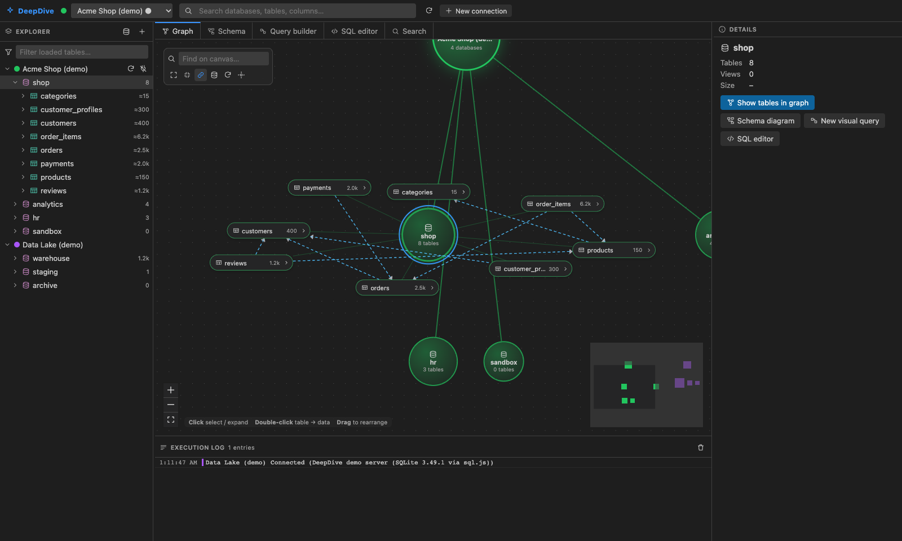
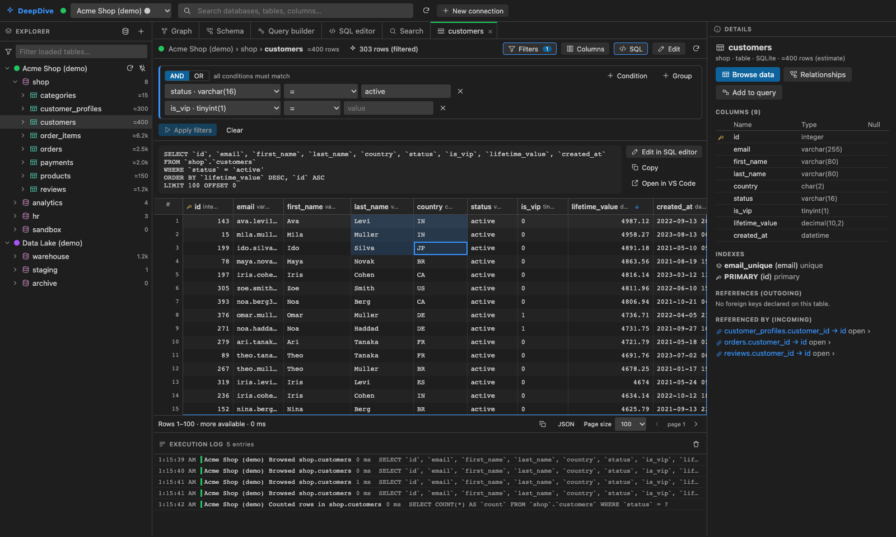
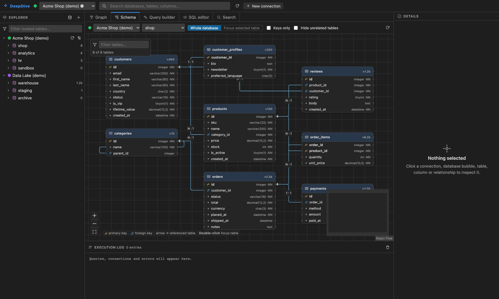
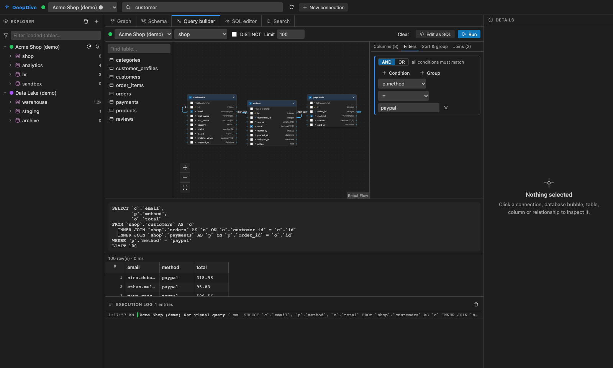
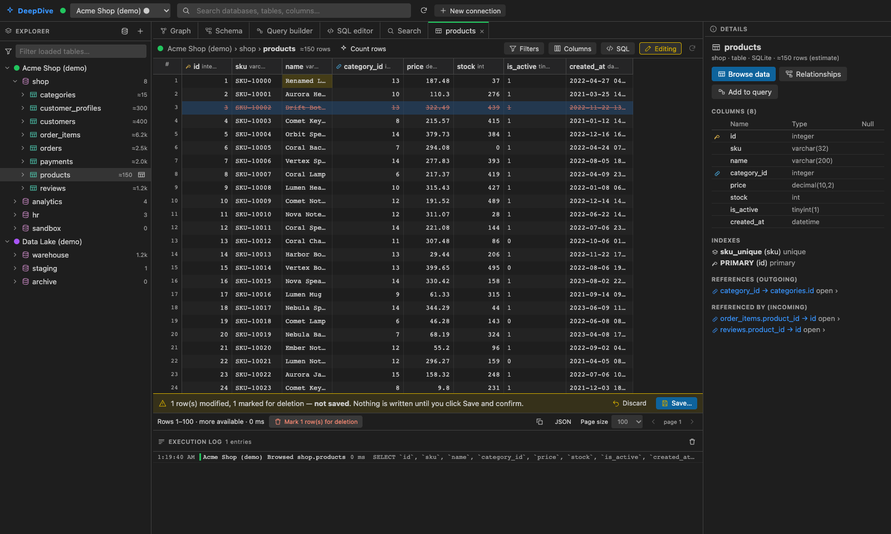

# DeepDive — Visual MySQL Explorer for VS Code

DeepDive turns your MySQL servers into an interactive, explorable map. Instead of starting from a tree and a blank SQL editor, you start from a **canvas of bubbles**. Connections are root nodes, databases are bubbles sized by their table count, and tables orbit the database you open. From there you can drill into schemas, follow foreign keys, filter rows visually, build joins by dragging between columns, and drop into SQL whenever you want.



| Data browser | Schema relationships |
| --- | --- |
|  |  |
| **Visual query builder** | **Safe editing** |
|  |  |

## Features

- **Multiple connections.** Save as many servers as you like, each with its own colour, environment tag (a `production` tag shows a warning badge) and read-only flag. Up to `deepdive.maxActiveConnections` can be connected at the same time, and switching between them keeps your tabs, query builder and editor state.
- **Bubble canvas** (the default view). It shows Connection → Database → Table → Columns. Click a database bubble to expand its tables, click a table to inspect it, and double-click a table to browse its data. You can expand a table node to see its columns and click a column for its type, nullability, default, keys and indexes. The canvas supports pan, zoom, dragging nodes, a minimap, find-on-canvas, expand/collapse all, and optional foreign-key edges between tables. Large databases show the first N tables plus a "+N more" node.
- **Schema diagram.** An ERD drawn from the real primary keys, foreign keys and indexes, with column-to-column edges. Cardinality is labelled `N : 1`, or `1 : 1` when a unique index on the referencing columns proves it. You can view the whole database or focus on one table with 1–3 hops of related tables, switch to "keys only", hide unrelated tables, and click any relationship to see its definition. **Relationships are never guessed**: a database without foreign keys shows no edges, and says so.
- **Data browser** (one tab per table):
  - Server-side paging with no automatic `COUNT(*)`. Row counts are estimates until you click *Count rows*.
  - Multi-column sorting, a column chooser with reordering, and resizable columns.
  - An AND/OR filter builder with nested groups. It handles text, numbers, dates, NULL and booleans.
  - The generated SQL is shown and can be opened in the SQL editor.
  - Copy a cell range, rows, a page as TSV, or JSON.
- **Safe editing.** Off by default and only offered for tables with a primary key on connections that aren't read-only. Changes stay local until you click **Save**. You then confirm the exact statements in a VS Code modal, and they run in one transaction. If any statement doesn't affect exactly one row, everything is rolled back.
- **Visual query builder.** Add tables, tick columns, and drag between column dots to create INNER/LEFT/RIGHT joins. Joins suggested from foreign keys are one click away, but none are ever added automatically. You can also set aggregates, aliases, AND/OR filters, ORDER BY, GROUP BY (added automatically when needed), DISTINCT and LIMIT. The SQL preview is compiled and validated by the extension host. *Edit as SQL* sends the query to the SQL editor and keeps the visual model.
- **SQL editor.** CodeMirror with MySQL highlighting and autocomplete for the current database's tables and columns. It runs the selection or the whole script (Cmd/Ctrl+Enter), shows results per statement, and has history, cancellation, and *Open in VS Code*. You can also send SQL from any `.sql` file (or its selection) to this editor with **DeepDive: Open SQL in DeepDive Editor**.
- **Global search.**
  - **Metadata search** finds databases, tables and columns across all connected servers, with filters by connection, database and type.
  - **Data search** needs an explicit scope (one connection, one database, chosen tables). Each table query is bounded by a LIMIT and the query timeout. Progress is shown live and the search can be cancelled.
- **Execution log.** Every query is logged with its timing and row count. Click an entry to reopen the SQL.

## Try it without a database (demo mode)

Run **DeepDive: Add Demo Connection** (or click **Try demo** in the toolbar). It adds two offline servers that run entirely inside the extension, using SQLite compiled to WebAssembly:

- **Acme Shop (demo)** has these databases:
  - `shop`: customers, orders, order lines, payments and reviews, with real foreign keys, including a composite key, a self-reference and a 1:1 relationship.
  - `analytics`: deliberately has **no** foreign keys.
  - `hr`: a small staff database.
  - `sandbox`: empty.
- **Data Lake (demo)**: a `warehouse` database with **1,201 tables**, for trying the large-schema behaviour.

Demo connections are writable, so you can try editing safely. The data lives in memory and resets when you reconnect. The demo engine is SQLite, so some MySQL-only functions won't work there; table names are unique across demo databases, so unqualified names still work.

## Getting started (development)

Requirements: Node.js 18+ (developed on Node 22) and VS Code 1.90+.

```bash
cd deepdive
npm install
npm run build        # bundles dist/extension.js, dist/webview.js(.css) and copies sql-wasm.wasm
```

### Launch in the Extension Development Host

1. Open the `deepdive` folder in VS Code.
2. Press **F5** (or *Run and Debug → Run DeepDive Extension*). The pre-launch task builds the project first.
3. In the new window, click the **DeepDive** icon in the activity bar and then **Open DeepDive Workspace**, or **Add Demo Connection**.

While developing, run `npm run watch` to rebuild on every change, then use *Developer: Reload Window* in the host window. To debug the webview, run *Developer: Open Webview Developer Tools* in the host window. Extension-host logs go to the **DeepDive** output channel.

### Browser dev harness (no VS Code needed)

```bash
npm run dev:browser          # http://127.0.0.1:5178   (?theme=light for light mode)
```

This serves the real webview under the same nonce-based CSP the extension uses. Behind it are the real router, connection manager and drivers (demo and MySQL). Write confirmations are declined by default; set `DEEPDIVE_DEV_CONFIRM=1` to auto-accept them. This is handy for UI work and screenshot-based testing.

### Checks

```bash
npm run typecheck    # strict TypeScript for host + webview
npm run lint         # eslint (typescript-eslint, react-hooks)
npm test             # unit + integration tests (demo engine, fake drivers)
npm run smoke        # activates the *bundled* extension against a mocked VS Code API
npm run check        # all of the above + build
```

Tests against a real MySQL server are opt-in:

```bash
docker run -d --rm --name deepdive-mysql-test -e MYSQL_ROOT_PASSWORD=deepdive-root-pw \
  -p 127.0.0.1:33061:3306 mysql:8.4
npm run test:mysql   # uses DEEPDIVE_MYSQL_HOST/PORT/USER/PASSWORD, defaults match the command above
```

They cover schema discovery (PK/FK/cardinality, views, odd identifiers), browsing and filtering through the router, LIKE escaping, injection attempts, read-only transactions, result truncation, server-side kill on timeout and cancellation, multiple connections, bad credentials and transactional edits.

## Packaging a VSIX

```bash
npm run package      # runs all checks, a production build, then `vsce package`
code --install-extension deepdive-mysql-0.1.0.vsix
```

The VSIX contains only `dist/`, `media/`, `README.md`, `CHANGELOG.md`, `LICENSE` and `package.json`. Everything, including `mysql2` and the SQLite WebAssembly file, is bundled.

## Configuration

| Setting | Default | Meaning |
| --- | --- | --- |
| `deepdive.queryTimeoutMs` | 30000 | Timeout for every user query. On MySQL the query is killed server-side (`KILL QUERY`). |
| `deepdive.maxResultRows` | 1000 | Rows kept per SQL-editor result; extra rows are discarded and the result is marked truncated. |
| `deepdive.pageSize` | 100 | Default page size in the data browser. |
| `deepdive.maxActiveConnections` | 8 | Connections that may be open at once. |
| `deepdive.poolSize` | 4 | Pool size per connected server. |
| `deepdive.graph.maxTablesPerDatabase` | 150 | Table nodes drawn per database before a "+N more" node. |
| `deepdive.search.maxTablesPerDataSearch` | 50 | Upper bound on tables in one data search. |

A sample connection (entered in the *New connection* form; the password goes to SecretStorage):

```text
Name: Local MySQL     Host: 127.0.0.1     Port: 3306     User: app_reader
Default database: app  TLS: Disabled       Read-only: ✓   Environment: development
```

For remote servers, set TLS to **Verify server certificate** and give a CA path. A dedicated read-only MySQL account is the strongest protection (see below).

## Architecture

```
┌──────────────── VS Code extension host (Node) ────────────────┐      ┌──────── Webview (React) ────────┐
│ extension.ts      commands, tree view, settings, SecretStorage │      │ App shell: toolbar, explorer,   │
│ WorkspacePanel    webview + strict CSP, forwards messages      │ ◀──▶ │ tabs, details, log              │
│ MessageRouter     zod-validates every request, dispatches      │ JSON │ GraphView    (@xyflow/react)    │
│ ConnectionManager configs, secrets, sessions, limits           │ msgs │ SchemaView   (@xyflow + dagre)  │
│ MetadataService   lazy, de-duplicated, invalidatable cache     │      │ TableDataView / DataGrid        │
│ QueryRegistry     cancellation by query id                     │      │  (TanStack Table + Virtual)     │
│ core/sql/*        identifiers, filters, query compiler, edits, │      │ QueryBuilderView (@xyflow)      │
│                   statement classifier, LIKE escaping          │      │ SqlEditorView (CodeMirror 6)    │
│ drivers/          MysqlDriver (mysql2 pool, streaming,         │      │ SearchView                      │
│                   KILL QUERY), DemoDriver (sql.js)             │      │ zustand store                   │
└───────────────────────────────────────────────────────────────┘      └─────────────────────────────────┘
```

- `src/shared/` holds the domain model and the **typed message protocol**: zod schemas plus a `ResponseMap` that gives every request a typed result. The webview only imports types; zod runs on the host.
- `src/core/` contains no VS Code code, so the router, services, SQL builders and drivers are all unit-testable and are reused by the browser harness.
- `src/extension/` holds the thin VS Code adapters (globalState, SecretStorage, settings, modal confirmations, clipboard, documents).
- `src/webview/` is the React UI. Credentials, SQL construction and execution never live here.

### Security model

- **Credentials.** Passwords are stored only in VS Code SecretStorage. Connection settings in `globalState` never contain them. The webview can send a new password, but the host never sends one back. Known passwords and common credential patterns are redacted from every error and log line.
- **Nothing from the webview is trusted.**
  - Every message is validated with zod: types, lengths, enums, depth and size limits.
  - Database, table and column names are checked against **live metadata** before they're used, then backtick-quoted with escaping.
  - Values are always bound as parameters.
  - LIKE wildcards in user input are escaped (`ESCAPE '!'`).
  - Aliases in the query builder must match `[A-Za-z_][A-Za-z0-9_]*`.
- **Read-only by default.**
  - New connections are read-only, and they refuse write statements and grid edits.
  - On writable connections, every statement the classifier can't prove is read-only needs an explicit **modal** confirmation that shows the SQL. Unknown statements, `SELECT … INTO OUTFILE` / `FOR UPDATE`, `/*! … */` executable comments, CTEs with DML, `CALL`, `SET` and so on all count as writes.
  - Read statements on MySQL run inside `START TRANSACTION READ ONLY`, so a side-effecting function can't write either.
  - The classifier is a safety net, not a security boundary. For hard guarantees, connect with a MySQL user that only has `SELECT`.
- **Transactions.** Grid edits run in one transaction and are reported as committed only after MySQL confirms `COMMIT`. Statements in the SQL editor use MySQL autocommit, and the result says the server confirmed them.
- **Driver hardening.** `multipleStatements` is off and `LOAD DATA LOCAL INFILE` is disabled (`-LOCAL_FILES`). Large integers and DECIMALs that would lose precision are returned as strings.
- **Webview.** The CSP is `default-src 'none'`, with scripts and `<style>` elements allowed only by nonce. Local resources are restricted to `dist/` and `media/`, and React rendering means no raw HTML injection.

### Performance and reliability

- Metadata is loaded lazily: databases, then tables, then table details or the full schema only when needed. It's cached per connection with in-flight de-duplication, and you can refresh per connection or per database.
- Result sets are streamed. Once the row limit is reached, DeepDive stops reading, kills the rest of the query and discards that pooled connection. The data browser uses `LIMIT … OFFSET` with one extra row to detect another page, with a primary-key tiebreaker for stable ordering.
- Timeouts and cancellation use `KILL QUERY` through a short-lived side connection, so they work even when the pool is busy. Disconnecting cancels that connection's running queries, and deactivating closes every pool.
- In the UI, the explorer and grid rows are virtualized and canvases render only visible elements. Large databases are capped on the bubble canvas and in the schema diagram, which switches to keys-only above 60 tables.

## Implementation plan and status

| Milestone | Status |
| --- | --- |
| M1: Core: protocol, identifier/filter/query builders, classifier, drivers (MySQL + demo), services | ✅ done, unit + integration tested |
| M2: Extension shell: commands, tree view, SecretStorage, webview with CSP, router wiring | ✅ done, smoke-tested on the bundled output |
| M3: Bubble canvas + explorer + details panel | ✅ done |
| M4: Data browser: paging, sort, filters, column chooser, SQL panel, copy, editing | ✅ done |
| M5: Schema diagram, query builder, SQL editor, global search | ✅ done |
| M6: Real-MySQL test suite, browser harness, README, VSIX packaging | ✅ done |

### Known limitations and incomplete features

- SQL → visual model is one-way: the builder can produce SQL, but hand-written SQL isn't parsed back into the builder.
- Grid editing supports **update** and **delete** of rows addressed by primary key. **Inserting** rows, editing views, editing tables without a primary key, and BLOB editing aren't supported.
- No SSH tunnelling yet; use a local port-forward. TLS supports CA, client cert and key files, but not key passphrases.
- The SQL editor splits scripts on `;`. `DELIMITER` blocks (stored-procedure bodies) aren't supported, and session state such as variables or temporary tables doesn't persist between runs, because statements use pooled connections. `USE db` inside a script applies to the rest of that script.
- Paging uses `OFFSET`, which gets slower on very deep pages of huge tables. Keyset pagination isn't implemented yet.
- Metadata queries use a fixed 60 s timeout and can't be cancelled from the UI.
- Canvas node positions are kept for the session only, not persisted between VS Code restarts.
- Cardinality is shown only as `N : 1` / `1 : 1` (from unique indexes); optional versus mandatory isn't drawn.
- Automated tests cover the host, core and bundle (with a mocked VS Code API), plus browser-driven checks of the webview. There's no `@vscode/test-electron` suite yet.

## Project layout

```
src/shared      model.ts, protocol.ts (zod schemas + typed request/response map)
src/core        router.ts, errors.ts, settings.ts
  sql/          identifiers, lexer, classify, literals, filters, tableQuery, queryModel, edits, search
  drivers/      driver.ts, mysqlDriver.ts, demoDriver.ts, demoData.ts, metadata.ts, serialize.ts
  services/     connectionManager.ts, metadataService.ts, queryRegistry.ts
src/extension   extension.ts, workspacePanel.ts, adapters.ts, connectionsTree.ts
src/webview     App.tsx, store.ts, components/, views/, lib/
src/dev         devServer.ts (browser harness, not shipped)
test/unit       builders, classifier, protocol, metadata helpers
test/integration demo.test.ts, connections.test.ts (fakes: timeouts, cancellation, limits, secrets), mysql.test.ts
scripts         build.mjs, dev-server.mjs, smoke.cjs
```
